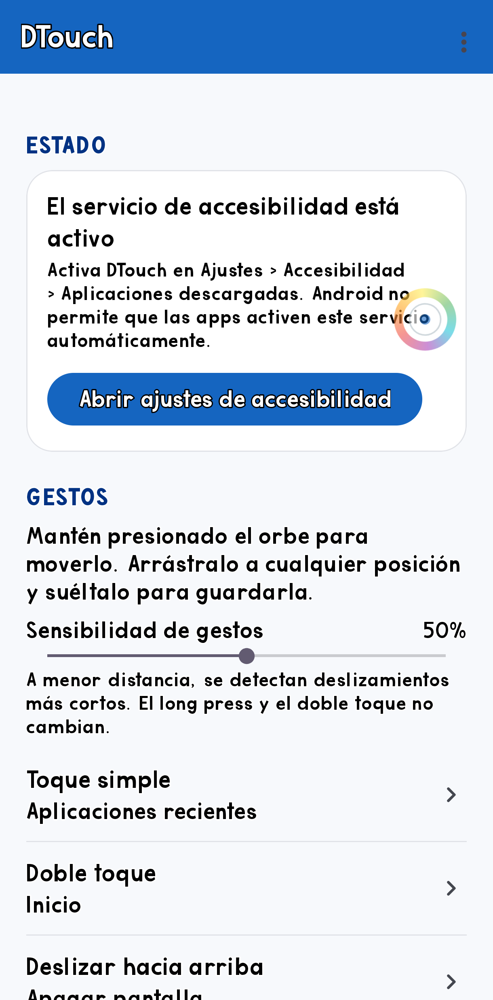

<p align="center">
  
</p>

<h1 align="center">DTouch</h1>

<p align="center">
  <strong>Tu Android, a un gesto del orbe.</strong><br>
  Un orbe flotante, doce estilos y gestos que se adaptan a ti.<br>
  Sin root. Sin anuncios. Sin Internet.
</p>

<p align="center">
  
  
  
  
  
</p>

<p align="center">
  
</p>

<p align="center">
  <em>Captura real en un POCO con Android 16.</em>
</p>

## Un orbe, todos tus atajos

DTouch pone un pequeño orbe flotante sobre cualquier aplicación. Desde ese orbe puedes volver atrás, ir al inicio, abrir las apps recientes, desplegar las notificaciones, apagar la pantalla o moverlo a donde quieras usando gestos.

Está pensado para usarse con una mano, sin buscar botones ni interrumpir lo que estás haciendo. No necesita root, no pide permiso para dibujar sobre otras apps y no se conecta a Internet.

|  |  |
|---|---|
| **Plataforma** | Android 6.0 o superior |
| **Precio** | Gratis |
| **Anuncios** | No |
| **Compras dentro de la app** | No |
| **Internet** | No requiere |
| **Datos personales** | No recopila |
| **Permiso principal** | Servicio de accesibilidad |

## Características

- **Seis gestos configurables:** toque simple, doble toque y deslizamientos en las cuatro direcciones.
- **Acciones útiles:** Atrás, Inicio, Recientes, Panel de notificaciones, Apagar pantalla o Ninguna.
- **Sensibilidad ajustable:** un slider cambia la distancia necesaria para reconocer un deslizamiento (32–80 dp; 50 % equivale al comportamiento clásico de 56 dp).
- **Doce estilos de orbe:** Clásico, Sólido, Anillo, Punto, Dúo, Medianoche, Escarcha, Aqua, Arcoíris, Aurora, Púlsar y Cometa.
- **Cuatro estilos con movimiento:** Arcoíris, Aurora, Púlsar y Cometa se animan en el orbe a 12,5 fps para no gastar batería.
- **Tamaño y opacidad:** de 32 a 80 dp y de 0 a 100 %, con vista previa inmediata.
- **Imagen personalizada:** elige una imagen del teléfono y úsala como orbe; se guarda solo en el dispositivo.
- **Posición persistente:** mantén presionado el orbe para moverlo; la posición se recuerda por orientación.
- **Privacidad por diseño:** sin Internet, sin analytics, sin publicidad y sin permisos de almacenamiento.
- **Cambios en vivo:** los estilos, el tamaño y la opacidad se aplican al orbe sin reiniciar el servicio.

## Estilos

|  |  |  |
|---|---|---|
| Clásico | Sólido | Anillo |
| Punto | Dúo | Medianoche |
| Escarcha | Aqua | Arcoíris |
| Aurora | Púlsar | Cometa |

**Arcoíris**, **Aurora**, **Púlsar** y **Cometa** tienen animación. La galería muestra una vista estática de cada estilo; el movimiento se ve en el orbe flotante.

## Privacidad

DTouch usa el servicio de accesibilidad para dibujar el orbe y ejecutar acciones globales (Atrás, Inicio, Recientes, Notificaciones y Bloqueo). **No lee el contenido de la pantalla, no usa `dispatchGesture`, no captura datos y no se conecta a Internet.**

- No hay anuncios, analytics ni SDK de terceros.
- No se pide `INTERNET`, `SYSTEM_ALERT_WINDOW` ni almacenamiento externo.
- La imagen personalizada se guarda en el almacenamiento interno de la app y nunca sale del dispositivo.
- El orbe se dibuja con `TYPE_ACCESSIBILITY_OVERLAY`, no con una ventana de superposición tradicional.

> DTouch es una herramienta de asistencia. Android exige que el usuario active manualmente el servicio de accesibilidad; la app no puede hacerlo por sí sola.

## Compatibilidad

|  |  |
|---|---|
| **Android mínimo** | 6.0 (API 23) |
| **Compilación / target** | Android 17 (API 37) |
| **Probado en** | Android 14 y Android 16 |
| **Root** | No necesario |
| **Permiso de superposición** | No necesario |
| **Idiomas** | Español e inglés |

## Instalación

DTouch está en **beta de desarrollo**. La versión pública se publicará en Google Play cuando esté lista.

Mientras tanto, puedes generar el APK desde el código:

```bash
./gradlew assembleDebug
```

En Windows:

```bat
gradlew.bat assembleDebug
```

El APK queda en:

```text
app/build/outputs/apk/debug/app-debug.apk
```

Instálalo en el teléfono con:

```bash
adb install -r app/build/outputs/apk/debug/app-debug.apk
```

Después abre DTouch y activa el servicio en **Accesibilidad > Aplicaciones descargadas > DTouch**.

## Desarrollo

Requisitos:

- Android Studio Rabbit 2 (2026.2.2) o superior.
- JDK 21.
- Android SDK Platform 37 y Build Tools 36.0.0.
- El wrapper de Gradle incluido (Gradle 9.5.0).

Comandos útiles:

```bash
./gradlew testDebugUnitTest
./gradlew assembleRelease
```

El manual técnico completo está en **[docs/TECHNICAL.md](docs/TECHNICAL.md)**: arquitectura, preferencias, permisos, decisiones de diseño, checklist de pruebas y guía para extender la app.

## Estado del proyecto

- Beta de desarrollo para pruebas en dispositivo.
- Build y tests verificados.
- Pendiente: publicación en Google Play y revisión visual final en Android 17.
- Las animaciones se pausan con la pantalla apagada o bloqueada para evitar consumo de CPU y cierres por parte del sistema.

## Contribuir

Las ideas, reportes de bugs y pull requests son bienvenidos. Antes de enviar un cambio:

1. Ejecuta `./gradlew testDebugUnitTest`.
2. Mantén la app sin permisos de Internet ni recolección de datos.
3. Respeta la divulgación de accesibilidad y el enfoque de privacidad.

## Licencia

Este proyecto se distribuye bajo la licencia **MIT**. Consulta [LICENSE](LICENSE).

## Créditos

- Inspirado en la idea del orbe flotante de J Touch 1.7.0-GP. DTouch es una implementación nueva e independiente, sin afiliación con J Touch.
- Construido con Kotlin, AndroidX, AppCompat y Material Components.
- Las capturas viven en [`docs/images`](docs/images) y se sirven desde GitHub.

---

## English

DTouch is a floating accessibility orb for Android 6.0+ with six configurable gestures, twelve orb styles and an adjustable swipe sensitivity. It requires no root, shows no ads, collects no data and does not use the Internet. The app is currently in beta; build it with `./gradlew assembleDebug`.
